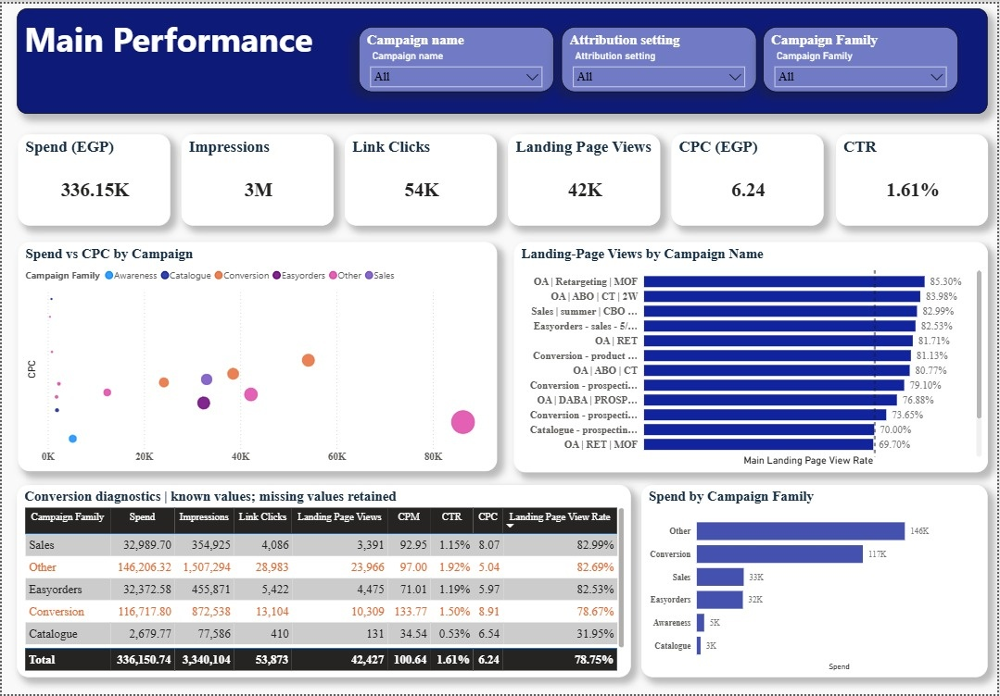
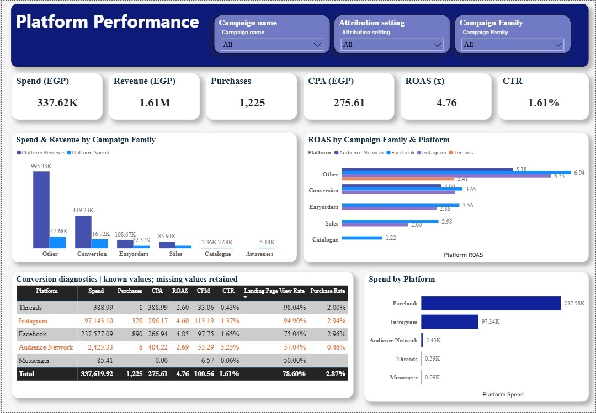
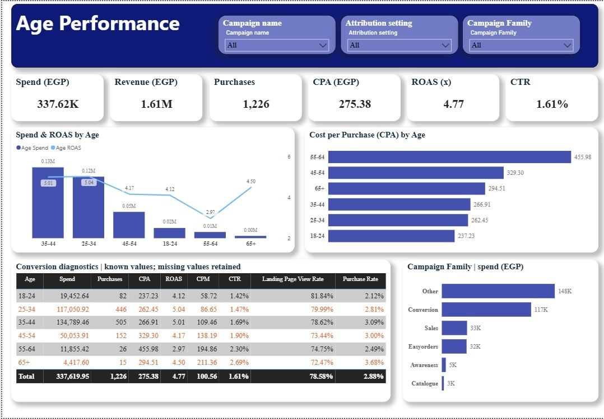
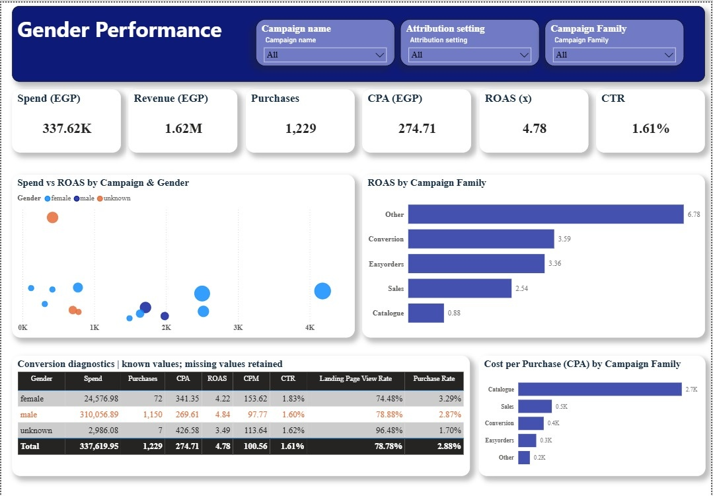

# Paid Social Campaign Analysis | Power BI

A four-page Power BI project exploring paid social campaign traffic, attributed purchase value and efficiency across campaigns, platforms, age groups and gender.

## Dashboard pages
- **Main:** spend, impressions, link clicks, landing-page views, CPC and CTR.
- **Platform:** spend and attributed purchase value, purchases, CPA and ROAS by platform.
- **Age:** audience performance by age group.
- **Gender:** audience performance by gender.

Each page includes campaign, attribution-setting and campaign-family slicers.

## Preview

## Tools and implementation
Power BI, Power Query and DAX. The report uses four separate loaded tables: Main, Platform, Age and Gender. Power Query handles type conversions, campaign-family classification and selected-column loading. DAX measures calculate traffic and conversion KPIs. No star-schema model or cross-table relationships are claimed.

## Repository contents
- `Paid-Social-Campaign-Analysis.pbix`: original supplied Power BI report, unchanged, with its embedded data and original local source references.
- `images/`: dashboard screenshots.
- `data/`: CSV extracts of the **processed tables loaded in the supplied report**, not the original raw exports.
- `measures/dax-measures.csv`: DAX measure names and expressions extracted from the report.
- `power-query/`: extracted transformation/source scripts. Original machine-specific source paths have been replaced with a neutral `RawFolder` example.

The original Power BI file is included unchanged. It contains the loaded data, not just dashboard images. Its source queries retain machine-specific local paths. Downloading the report may allow inspection of the embedded model; Power BI Desktop opening and behavior have not been tested as part of this repository preparation.

## Metric definitions
CTR = link clicks / impressions. CPC = spend / link clicks. CPA = spend / purchases. ROAS = attributed website purchase conversion value / spend. Landing-page view rate = landing-page views / link clicks. Purchase rate = purchases / landing-page views.

Attributed purchase value is not profit or proof of incremental revenue. Ratios are calculated from aggregate inputs within each view, not by averaging individual row rates.

## Interpretation and limitations
- The four breakdowns overlap and their totals differ. Do not sum the views or describe them as one reconciled total. The reason for the source differences is not established here.
- Attribution settings vary. Compare matching settings before drawing conclusions.
- Missing purchase/revenue values exist. Some Platform measures use a zero fallback for invalid denominators; Age/Gender measures use explicit blank checks. Their handling should be reviewed before comparisons.
- `Other` is the fallback for campaign names not matched by the campaign-family rules. It is not necessarily a single marketing strategy.
- The loaded tables omit reporting start/end dates. No exact reporting period is claimed.
- The source queries reference four raw CSV exports that are not included. The processed CSVs cannot replace those raw files as direct inputs to the original scripts. Refresh and interactive behavior have not been tested from this repository. To refresh the original report, obtain the matching raw exports and update its source references in Power BI Desktop. The processed CSVs here are not guaranteed drop-in replacements for those exports.

This is an analytics portfolio project. It does not claim a measured improvement in advertising results. No third-party dataset or software license is asserted.
